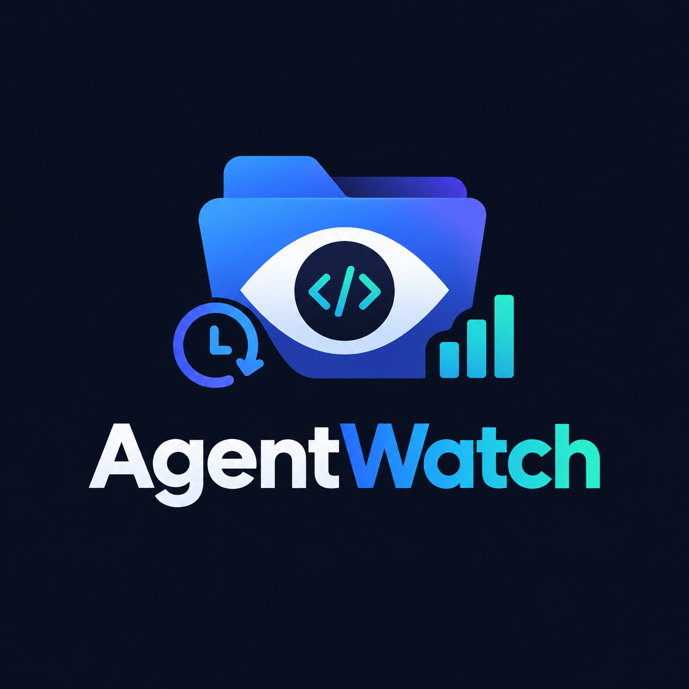

# AgentWatch

<p align="center"></p>

AgentWatch is a fully local dashboard for monitoring a project folder, recording meaningful checkpoints, and analyzing how code evolves over time. It is designed for developers working with AI coding agents or with their own local workflows, and keeps both data and analysis on the machine.

## 🌐 Live demo (testing only)

**https://agentwatch-henna.vercel.app**

> ⚠️ **This deployment is for testing and previewing only — not a working product.**
> - **Two sample demo projects** (`task-api`, `portfolio-site`) are pre-loaded with
>   snapshots, issues, plan items and terminal logs, so you can explore every view
>   immediately — no setup needed.
> - The serverless database is **ephemeral**: data resets when the instance goes
>   cold, then the demo data is re-seeded automatically.
> - Local-machine features (folder watching, terminal capture) are inactive in the
>   cloud, and AI summaries run on a free-tier Google Gemini key
>   (`gemini-flash-lite-latest`) instead of local Ollama models.
> - For the real experience, run AgentWatch locally (see below).

All deployment-specific code lives in the [`demo/`](demo/) folder as an overlay —
the main source tree is the original, untouched app.

## Why AgentWatch

- Watch a project directory without sending code to the cloud
- Save checkpoint snapshots for important changes
- Review diffs and file-level activity over time
- Track project health, plan items, dependency structure, and issues
- Surface console errors and connect them to recent changes
- Restore files from a snapshot only when explicitly approved
- Use local Ollama models for labeling and planning when available

## Core features

- Dashboard overview with health score, activity, recent errors, and project status
- Timeline view with checkpoints, diffs, and change summaries
- Project planning based on real repository evidence
- Dependency graph to inspect imports and broken relationships
- Function health analysis for complexity, duplicates, dead code, and stubs
- Console and error capture tied to project activity
- Snapshot browser and restore workflow
- Settings for project management, branding, and local intelligence providers

## Tech stack

- Next.js
- React
- TypeScript
- Tailwind CSS
- Prisma
- SQLite database
- Ollama support for local AI summarization and planning

## Requirements

- Node.js 20 or newer
- npm
- Internet access once during setup for installing dependencies
- Optional: Ollama installed locally for local AI intelligence

## Quick start on Windows

1. Open a terminal in this project folder.
2. Run:
   ```bash
   start.bat
   ```
3. The first run installs dependencies, initializes the local database, and starts the app.
4. Open the browser to:
   ```text
   http://localhost:4517
   ```
5. Click Add project and select the folder you want to monitor.

To stop the app, use:

```bash
close.bat
```

## Useful scripts

```bash
npm install
npm run dev
npm run build
npm run start
npm run rebrand -- "Your Name"
npm run db:push
```

## Local AI setup

AgentWatch can use your local Ollama models to generate checkpoint labels and planning text.

1. Install Ollama from https://ollama.com
2. Pull a local model, for example:
   ```bash
   ollama pull qwen2.5-coder:3b
   ```
3. In the app, go to Settings and choose Ollama as the intelligence provider.
4. Run the connection test to confirm the model is available.

If Ollama is unavailable, AgentWatch can still run in a fallback mode with built-in summaries.

## Data and privacy

AgentWatch is designed to stay local:

- project files are read locally
- analysis data is stored in the local database inside this project folder
- no project data is required to leave the machine
- the only write-back into a watched project happens when you explicitly choose Restore from a snapshot

## Project layout

```text
.
├── db/
├── demo/                  # hosted-demo overlay (testing only — see demo/README.md)
├── prisma/
├── public/
├── scripts/
├── src/
├── AGENTWATCH-GUIDE.md
├── close.bat
├── components.json
├── next.config.ts
├── package.json
├── README.md
├── setup.bat
├── start.bat
├── tailwind.config.ts
├── tsconfig.json
└── .gitignore
```

## Common troubleshooting

- If startup fails, run the batch file from a terminal to read the actual error output.
- If the port is already in use, edit the port value in `start.bat`.
- If Ollama is not reachable, make sure the Ollama service is running and the model is installed.
- To reset the app data locally, remove the local database and rerun setup.

## License

This project is a local workspace application for monitoring and analyzing software changes. Add your preferred license here if you plan to distribute it publicly.

## Notes

This repository includes a setup guide in [AGENTWATCH-GUIDE.md](AGENTWATCH-GUIDE.md), which contains more detailed operational instructions for the Windows workflow.
